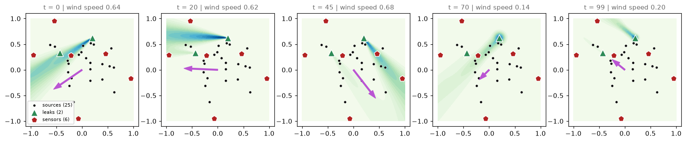
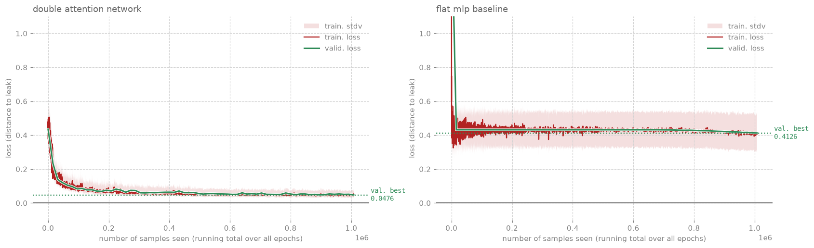
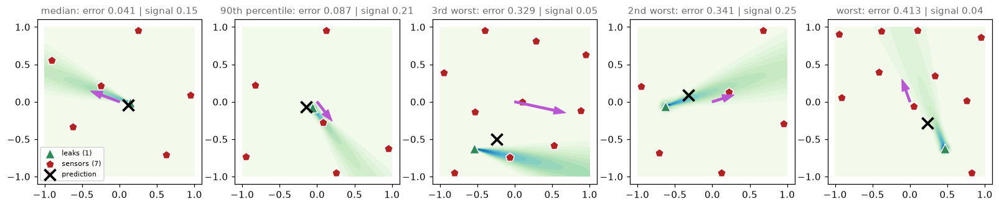

# leaknet

Locating gas leaks from a sparse sensor network with a small attention model, on synthetic data.

An exploration project. The idea comes from thinking about how to automate data operations for gas sensor networks: if a handful of sensors on a site report concentrations over time and the wind is known, can a network learn to point at the leak? Nothing in here is Sensirion code or data, every scene is simulated.

It is not a finished method. Locating a single leak works well, several leaks at once do not work yet, and the write-up below tries to be honest about both.

<p align="center"></p>

## What is in here

**The data** ([notebooks/01_scene_generation.ipynb](notebooks/01_scene_generation.ipynb)). A scene is a 2D site with 15-30 possible sources, of which 1-3 are leaking, 6-10 sensors and a random wind time series over 100 timesteps. A handmade plume formula gives every sensor a concentration per timestep. The model sees only sensor positions, readings and wind.

**Phase 1: one leak** ([notebooks/02_single_leak.ipynb](notebooks/02_single_leak.ipynb)). A "double attention" network: self attention over the sensors of each timestep, pooled to one vector per timestep, then self attention over the timesteps, pooled to one vector per scene, then a small mlp that regresses the leak position. The attention blocks are written by hand.

**Phase 2: several leaks** ([notebooks/03_multi_leak.ipynb](notebooks/03_multi_leak.ipynb)). Same encoder, different heads and losses for predicting a set of leaks of unknown size: slots with a differentiable sinkhorn matching, three variants of predicting a confidence heatmap, and a sanity check that only counts the leaks.

## Results

| experiment | setup | result |
|---|---|---|
| **single leak**, double attention | 16k train / 4k validation scenes | mean distance to the leak **0.048** (site is 2 wide), 0.054 on sensor layouts it has never seen |
| single leak, flat mlp baseline | same | 0.41, no better than always predicting the center (0.43) |
| **multi leak**, slots + sinkhorn matching | 45k / 5k scenes, 1-3 leaks | positions ok (0.13 from the matched leak), but never predicts fewer than two leaks: number of leaks correct in 50% of the scenes |
| multi leak, heatmap from gaussian blobs | overfit test, 8 scenes | collapses to an empty map |
| multi leak, heatmap from conv decoder | overfit test, 8 scenes | fits slowly, test too short to conclude |
| multi leak, heatmap from linear layer | overfit test, 12 scenes | memorizes the maps |
| multi leak, count the leaks | 800 / 200 scenes | 70% correct (guessing: 33%) |

<p align="center"></p>

The single leak model is the part that works: it finds the leak to within 2-3% of the site width, also on sites it was not trained on, and the errors that remain are mostly along the wind axis in scenes where hardly any sensor sits in the plume.

<p align="center"></p>

The multi leak part is unfinished. The sinkhorn model places its slots sensibly and fails on the confidences, one heatmap variant falls into a trap (predicting nothing is a good RMSE answer when the target is mostly empty), and the other two have only seen overfit tests so far. The details are in notebook 03.

## Setup

The project uses [uv](https://docs.astral.sh/uv/).

```bash
uv sync                      # creates .venv with python 3.12 and all dependencies
```

On Windows and Linux this installs a CUDA build of PyTorch (see `[tool.uv.sources]` in `pyproject.toml`), on macOS the default build. Everything also runs on the CPU, just slowly.

```bash
# 1. generate the datasets (a few minutes each, uses all cores)
uv run scripts/generate_scenes.py --n-samples 20000 --seed 0 --out data/single_leak_20k.h5
uv run scripts/generate_scenes.py --n-samples 50000 --n-leak-max 3 --seed 1 --out data/multi_leak_50k.h5

# 2. run experiments (settings are in leaknet/train.py), writes loss history + weights to results/
uv run scripts/train.py single_leak mlp_baseline
uv run scripts/train.py sinkhorn blobs conv_heatmap linear_heatmap count

# 3. look at them
uv run jupyter lab notebooks
```

The histories and weights of my runs are checked in under `results/`, so the notebooks only need the datasets from step 1.

To watch a training live, there is a plot widget for notebooks that updates after every batch:

```python
from leaknet.plotting import TrainingPlotter
from leaknet.train import run_experiment

plotter = TrainingPlotter(n_epochs=63, l_dataset=16000)
model, history = run_experiment("single_leak", data_dir="../data", plotter=plotter)
```

## Layout

```
src/leaknet/
  simulation.py   plume formula, wind, sensor layouts, scene generation, hdf5 writing
  data.py         loading scenes, ScheduledBatchSampler (batch size schedule)
  attention.py    SelfAttention, AttentionPooling
  models.py       the double attention encoder, one head per experiment, flat mlp baseline
  losses.py       distance loss, sinkhorn matching loss, heatmap losses
  train.py        training loop, the list of experiments and their settings
  plotting.py     live training plot (plotly widget), static plots, scene views
scripts/          generate_scenes.py, train.py
notebooks/        01 scene generation, 02 single leak, 03 multi leak
results/          loss histories (json) and weights (pt) of the runs shown in the notebooks
docs/             figures for this readme, screenshots of the live training plot
```

## Limitations and what I would do next

Roughly ordered by how much I think they matter. None of these are fixed in the code yet.

### The data

**Only 50 sensor layouts, shared by training and validation.** Every scene picks one of 50 pregenerated layouts, so each layout shows up in hundreds of training scenes and the validation scenes reuse them. The validation loss therefore measures "new leak and new wind on a layout I know by heart", not "new site". A test with 500 scenes on fresh layouts (notebook 02) shows that the error only goes from 0.048 to 0.054, so the model generalizes far better than this setup has any right to show. It is still the wrong way to validate. The fix is a new layout per scene, which the generator can already do (`--n-sensor-patterns 0`). The attention network trains just as well on such a dataset (0.048 validation, 0.052 on unseen layouts); the flat mlp on the other hand memorizes the layouts as soon as every scene has its own.

**The plume has no memory.** The concentration at a sensor at time `t` only depends on the wind at time `t`. There is no transport delay, no build-up and no noise. This makes the timesteps of a scene independent observations, and it is the reason why a model without any notion of time order (see below) can work at all. It also makes the data much easier than reality, where the gas that arrives now was released under the wind of a few minutes ago. A time-stepped advection-diffusion simulation (or at least a puff model) plus sensor noise would be the next step.

**The plume formula is a drawing, not physics.** `atmospheric_dispersion` is tuned by eye. It has the right qualitative behaviour (blob in calm air, cone downwind) but for example the width of the cone does not depend on the wind speed and the calm-air blob covers a large part of the site. Anything learned here says little about real plumes. The standard gaussian plume model would be just as easy to implement.

**Most readings are exactly zero.** Concentrations are rounded to 5 decimals before the log-normalization, so everything outside a plume is a hard 0. More than half of all readings are 0, and a scene where the wind happens to blow the plume past all sensors contains almost no information. That is partly realistic (detection limits exist), but it also means that part of the remaining error is not the model's fault. Notebook 02 shows how the error depends on this.

**Leak positions are biased.** Sources are normalized so that their bounding box is exactly `[-0.625, 0.625]`. The outermost sources therefore sit exactly on the border of that box, and so does the leak in about 18% of the scenes. Leaks never occur in the outer third of the site, where the sensors still are. The network picks up both regularities as a prior (visible in the scatter plots of notebook 02).

**Weak leaks.** The leak rate is uniform in `[0, 1]` and constant over time. A leak with a rate near 0 is practically invisible, which matters most for the multi-leak scenes, where it sits next to stronger ones (about 5% of all leaks have a rate below 0.05).

**Small things.** The pull of the wind direction towards its bias does not wrap around, so the wind sometimes turns the long way round.

### The model

**Padded sensors take part in the self attention.** Scenes with fewer than 10 sensors are padded, with a mask. The mask is only passed to the attention *pooling*, not to the two self attention layers before it (`models.py`, `DoubleAttentionEncoder.forward`). So every real sensor also attends to up to four fake sensors at position (0, 0) with concentration -1. The network can learn to ignore them because -1 never occurs otherwise, but it has to spend capacity on it and the features of a real sensor depend on how many fake ones are next to it. The fix is one argument: `self.scene_attention_1(x, M)`.

**The wind direction goes in as a raw angle.** It is a number in `[0, 2π)`, so two almost identical directions just left and right of 0 are as far apart as possible in feature space, and the first linear layer has to deal with a jump. `(sin, cos)`, or directly the wind vector `speed * (cos, sin)`, would be continuous. Similarly the sensor positions could be given relative to the wind (rotate every timestep into the wind frame), which would hand the network the symmetry of the problem for free.

**Time is a bag, not a sequence.** There is no positional encoding in the time attention and the pooling is a weighted sum, so the model is invariant to shuffling the timesteps. With the memoryless plume above this is actually the correct inductive bias, but it is not a deliberate choice, and it would be wrong the moment the simulation gets transport delays.

**Small and plain attention blocks.** Single head, feature size 20 for the sensor stage, no normalization layers, a residual connection only around the attention and not around the linear layers in between. It trains fine at this depth, but multi-head attention with pre-norm blocks (or just `nn.TransformerEncoderLayer`) would be the obvious upgrade. Writing the blocks by hand is for learning, not because it is needed.

### Training and evaluation

**No test set.** The validation set is used for everything, including picking the best epoch.

**Batch size schedule instead of learning rate schedule.** Doubling the batch size from 32 to 1024 at a constant learning rate has a similar effect to decaying the learning rate and it works well here. There is no comparison against a plain cosine schedule though, so I cannot say it is better, only that the large batches make the later epochs fast.

**Overfit tests with very few steps.** The heatmap variants are judged on 1000-2000 epochs of a single batch, which is only 1000-2000 optimizer steps at a learning rate of 1e-3. That is too short to judge two of the three: the linear head needs about 250 steps just to leave its initial plateau, and the conv decoder is still improving when its test ends.

### The sinkhorn loss

**Confidences saturate and cannot come back.** This is what actually breaks the run (notebook 03): two of the three slots end up with a confidence logit around +13 for every scene, so the model always claims at least two leaks and pays the false positive penalty on every single-leak scene. The loss would prefer to switch a slot off there, but through a saturated sigmoid there is no gradient left to do it. A confidence loss in logit space (binary cross-entropy on the matched / unmatched slots) does not have this problem.

**The penalties for missed and hallucinated leaks are half as big as intended.** A missed leak should cost the expected distance between two random points on the site. The constant in the loss is the closed form for the unit square (0.52), but the site is `[-1, 1]^2`, where it is 1.04. It makes the confidence part of the loss weak compared to the distance part.

**The assignment is soft and gradients flow through it.** With temperature 0.1 the permutation matrix is not close to a hard assignment when two leaks are at similar distances. The TP term `sum(distance * permutation)` then contains cross terms that pull a slot towards several leaks at once, i.e. towards their mean. And because the permutation is part of the graph, the network can also lower the loss by changing the assignment instead of the positions. In practice the slots do not collapse (they end up 0.13 from their matched leak, the mean of the leaks would be 0.3 away), so this hurts less than I expected, but it makes the loss hard to reason about. The usual recipe (DETR) is a hard hungarian matching that is treated as a constant, followed by plain per-pair losses.

**Inconsistent normalization.** The TP term is divided by the number of leaks in the scene, the FN and FP terms are not, so scenes with three leaks weigh the penalties more heavily than scenes with one. The division would also be a division by zero for a scene without leaks (there are none in the data).

### The heatmap losses

**The target is mostly empty, and RMSE does not mind.** The wind covariance that shapes the target blobs shrinks at every timestep and mostly ends up close to its floor, so a blob has a standard deviation of roughly 0.07 to 0.13: a handful of pixels. Only about 7% of the map is foreground. A map that is zero everywhere already has an RMSE of 0.11 to 0.14, against 0.3 to 0.5 at initialization, so the first thing gradient descent finds is "predict nothing". The blob model reaches that point within ten steps and never leaves it (notebook 03). The class weighting in the conv variant and the bigger blobs in the linear variant are patches for this. The established answer for this exact situation is a pixel-wise focal loss on a sigmoid map (CornerNet / CenterNet), with a positive weight on the peak pixels.

**The blob parametrization fights the optimizer.** The means are clamped to `[-1, 1]` (zero gradient once outside), the two eigenvalues go through a sigmoid, so every blob starts at a variance of around 0.5 and covers the whole map, and the angle is the raw output times 2π, so tiny weight changes spin the blob. A blob that does not overlap its target also gets almost no gradient that tells it where to move. Predicting an offset from a coarse grid cell and a log-variance would be much better behaved.

### Next steps

1. Fix the data first: new sensor layout per scene, a plume with memory and noise, a real train / validation / test split with unseen layouts.
2. Give the model the geometry: wind as a vector, sensor mask in the attention, proper transformer blocks.
3. For several leaks: slots with hard hungarian matching and no gradient through the assignment, or a CenterNet style heatmap with focal loss plus offset regression. Both are standard and both avoid the problems above. Before that, simply train the conv and the linear heatmap head on the full 50k scenes.
4. Predict uncertainty instead of a point. The wind covariance is an attempt to express "the leak is well located across the wind and badly along it". Predicting a gaussian per leak and training with its negative log-likelihood would let the model say that itself.
5. Add a classical baseline. The forward model is known here, so fitting the leak position by least squares on the plume formula is possible and would show how much of the remaining error is in the data and how much is the network's.
